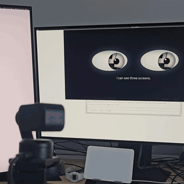
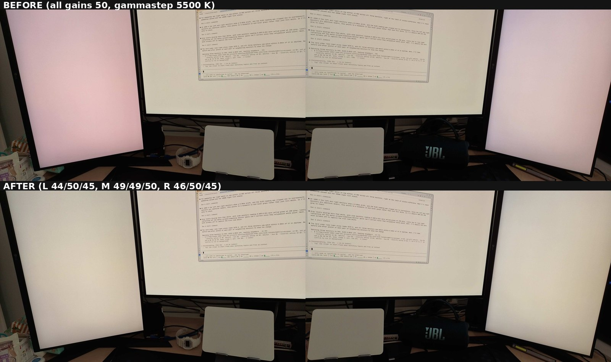
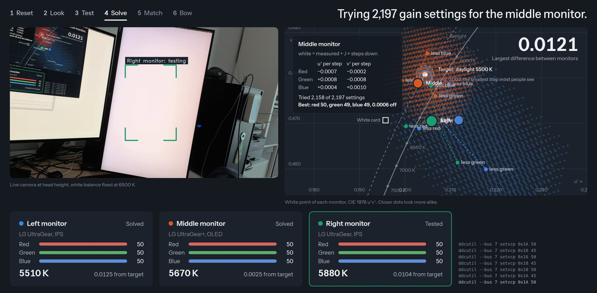
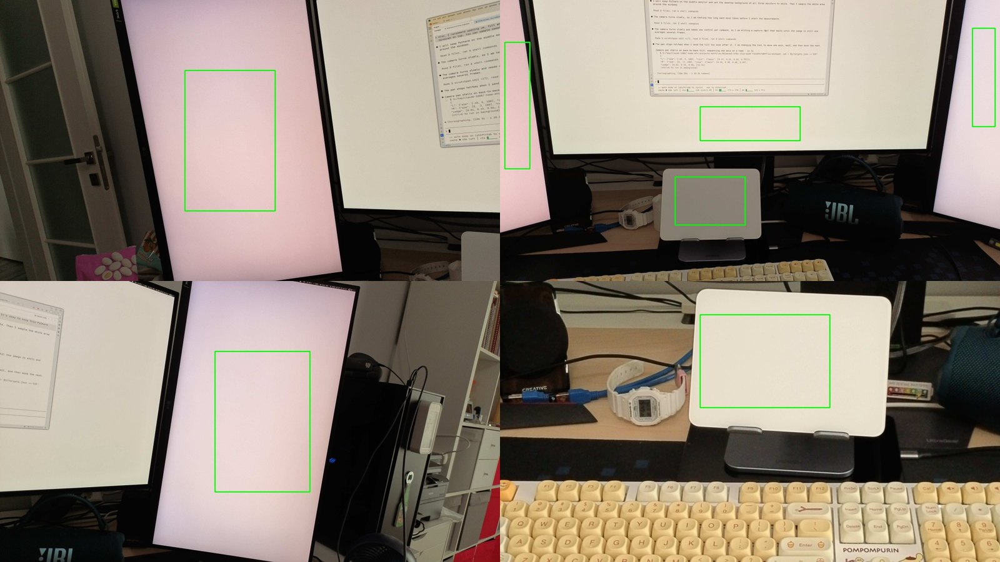
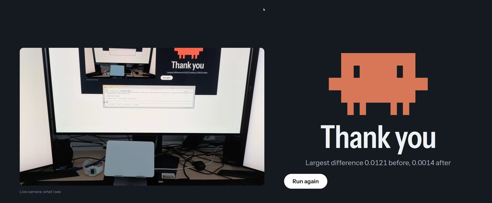

# monitor-white-match

Make the white of up to three monitors match. A pan/tilt webcam at head height measures each screen, and the tool sets the red, green, and blue gains inside each monitor over DDC/CI (the control channel in the display cable).

[](https://www.youtube.com/watch?v=_XNaYAK0XjM)

Click the GIF, or [watch the full run on YouTube](https://www.youtube.com/watch?v=_XNaYAK0XjM).

The run is also a show for a video. Two eyes open on a black screen and look around while the real camera turns with them. The page then narrates every step, and at the end a pixel mascot bows while the camera tilts down.

## Result

On the setup that this repository was built on, the largest difference between the three whites went from 0.0127 to 0.0007 u′v′ (a CIE color distance, where people see about 0.002). The target was CIE daylight D55, which was also the white of a paper card under daylight.



Before (top) and after (bottom). Before, the left monitor is clearly pink. The camera lens adds a small tint near the edges of each photo.

## How it works

The correction lives inside the monitors, so it works in any session (the desktop, the login screen, the lock screen) with no software running.

1. The camera white balance is fixed (6500 K by default), so every reading uses the same color scale.
2. For each monitor, the camera turns until a white area of that screen is in the center of the frame. Then it averages 10 frames inside a measurement box.
3. Each reading goes from camera colors to linear light, then to CIE u′v′, color temperature (K), and Duv (green or pink tint).
4. The tool drops each gain by 5 steps and measures the color shift per step.
5. A linear model (white = measured + shift per step × steps) scores all 2,197 gain settings (13 per channel) and picks the one closest to the target.
6. The tool sets the gains, measures again, and tries neighboring settings until each monitor is within about 0.001 of the target.



## Requirements

- Linux with `v4l2-ctl` (package `v4l-utils`) and `ddcutil`
- Python 3.10 or newer with the packages in `requirements.txt`
- Monitors that accept DDC/CI gain codes 16, 18, and 1A (video gain red, green, and blue). Many monitors do.
- A UVC webcam with pan, tilt, and zoom controls, at the position of your head. This repository was built with an Insta360 Link 2.
- A browser for the show page. Chrome or Chromium works.
- Optional: `gammastep`, for a target that follows its color temperature
- Optional: sway, for the command that turns every desktop background white

## Setup

1. Install the tools:

    ```sh
    sudo apt install v4l-utils ddcutil
    pip install -r requirements.txt
    ```

2. Make sure that your user can use the I2C buses. On most systems, add your user to the `i2c` group and log in again.
3. Copy the example configuration:

    ```sh
    cp config.example.json config.json
    ```

4. Find the I2C bus of each monitor, and write it as `bus` in `config.json`:

    ```sh
    ddcutil detect --brief
    ```

5. Make sure that each monitor lists the three gain codes:

    ```sh
    ddcutil --bus 5 capabilities | grep -E 'Feature: (16|18|1A) '
    ```

6. Find the stable camera path, and write it as `camera.device`:

    ```sh
    ls /dev/v4l/by-id/
    ```

7. Find a camera aim for each monitor. Then open `captures/left_grid.jpg`, where each grid cell is 10 % of the frame:

    ```sh
    python3 measure.py shot left -40 5 100
    ```

8. Write the aim (pan and tilt in degrees, zoom in percent) as `aim`, and a box on a white area as `roi`. The `roi` is `[x0, y0, x1, y1]` in fractions of the frame.
9. Turn every desktop background white. Then make sure that each box covers white only:

    ```sh
    python3 measure.py target L M R
    ```

    Each line must show `clipped 0.0%`. If it does not, lower `camera.brightness`. The command also saves `captures/target_<id>.jpg` with the box drawn in.

10. Start the server:

    ```sh
    python3 show_server.py
    ```

11. Open `http://127.0.0.1:8917/` in a browser window on the monitor that `ui_monitor` names. Keep the measurement box of that monitor free of windows.
12. Click "Wake me up", or press Space. One run takes about 3.7 minutes.



Example aims: the left monitor, the middle monitor, the right monitor, and the white card. The green box is the area that each reading averages.

Browsers play sound only after a click or a key press on the page. To start a run with sound from a script on sway, focus the window and send a key with `wtype -k space`.

To start a run without the page, use `python3 show_server.py --start`. To store the result in each monitor at the end of a run, add `--save` (it runs `ddcutil scs`).

## Configuration

| Key | Meaning |
| --- | --- |
| `camera.device` | Camera path, for example `/dev/v4l/by-id/usb-...-video-index0` |
| `camera.white_balance_k` | Fixed camera white balance during a run |
| `camera.home` | Camera aim (pan, tilt, zoom) for the opening and the bow |
| `camera.brightness` | Camera brightness control during a run, or `null`. A lower value lowers the auto exposure. |
| `target` | `"gammastep"` (daylight at the temperature gammastep applies now) or a temperature in K, for example `6500` |
| `white_background_cmd` | Shell command that turns every desktop background white, or `null` |
| `ui_monitor` | The monitor that shows the page. It does not dim during the bow. |
| `monitors` | One to three monitors, left to right: `id`, `name`, `model`, `bus`, `aim`, `roi` |
| `card` | Optional white reference, measured for the chart only: `name`, `aim`, `roi` |

## What the run changes

- A run sets the gains of each monitor. It turns each channel to 0 for 1.5 seconds, so the screen flashes cyan, magenta, and yellow.
- During the bow, the other monitors dim to brightness 0 for about 3 seconds.
- If more than half of a measurement box is near the top of the camera range, the run lowers `camera.brightness` by 10 and measures again.
- At the end, or after an error, the run puts back the monitor brightness and the camera controls. After an error, it also puts back the gains from before the run.
- Without `--save`, a monitor can lose the new gains when it powers off. Use `--save`, or run `ddcutil --bus N scs`.

## Limits

- One gain set matches the monitors at one gammastep temperature. Panels with different primaries (base colors), for example OLED and IPS, drift apart at other temperatures.
- Gains set only the white point. Grays follow the tone curve of each panel, and the gains do not change that.
- A camera does not see color exactly as an eye does. Repeat runs differ by about 0.002.
- The camera needs steady light. In daylight, repeat readings agreed within 0.0005. At night under a warm gammastep tint, they drifted by up to 0.0045. For a night run, pause gammastep and use a fixed `target`.
- Each step on many IPS monitors is about 4 to 5 % of light, so the best match is often 0.001 away from the target.



## Files

| File | Purpose |
| --- | --- |
| `show_server.py` | The run, the HTTP server, the camera stream, and the narration events |
| `index.html` | The show page |
| `measure.py` | Setup tool: aim, measure, and test gain steps |
| `camera.py` | Camera control, stillness detection, and color readings |
| `cie.py` | Color math |
| `ddc.py` | Monitor gains and brightness through `ddcutil` |
| `config.py` | Loads and checks `config.json` |

## License

MIT. See `LICENSE`.

The pixel mascot is the Claude Code logo. This project is not affiliated with Anthropic.
